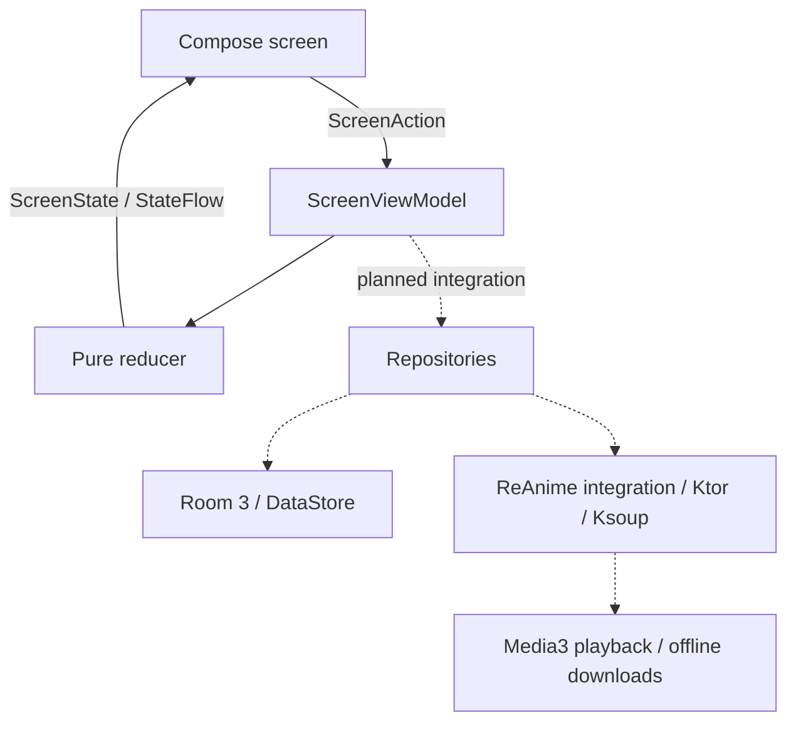

<div align="center">

# ReAnime

**Anime, with a native Android experience.**

A Kotlin-first Re:ANIME client built around Compose, MVI, and Android-native playback.

[](https://github.com/Act-Aks/reanime/actions/workflows/ci.yml)


[Getting started](#getting-started) · [Architecture](#architecture) · [Roadmap](#roadmap) · [Contributing](CONTRIBUTING.md)

</div>

> [!IMPORTANT]
> **Early development — not a working streaming app yet.** The current build is a
> native foundation screen. Catalogue access, streaming, downloads, the local
> library, and in-app updates are not connected. There is no public release yet.

## The idea

ReAnime is focused on **one source, a fully native interface, and a reliable
watching experience**—not a website inside a WebView or a multi-provider plugin app.
Interaction inspiration comes from Nuvio, Cloudstream, and similar clients.

| Discover | Watch | Take it offline |
| :--- | :--- | :--- |
| Native browsing, search, anime details, and episode lists | Media3 playback, available tracks/subtitles, resume, and picture-in-picture | Episode queues, storage controls, and offline playback |

*These are product goals, not features available in the current build.*

## What exists today

- **Native shell:** Compose/Material 3 theme with Navigation 3 home/about entries.
- **MVI example:** immutable screen state, actions, a pure reducer, and saved-input restoration.
- **Dependency wiring:** Koin with entry-scoped ViewModels.
- **Build foundation:** catalog-driven convention plugins, formatting, static analysis, and tests.
- **CI definitions:** PR-title validation, Android SDK/JDK setup, debug checks, and a minified release-build check.

## Stack

| Layer | Technology | Status |
| :--- | :--- | :--- |
| Interface | Kotlin · Jetpack Compose · Material 3 | Foundation implemented |
| Presentation | MVI · ViewModel · Coroutines · StateFlow | Example implemented |
| Navigation & DI | Navigation 3 · Koin | Connected |
| Requests & parsing | Ktor 3 · kotlinx.serialization · Fleeksoft Ksoup | Source integration planned |
| Local data | Room 3 · SQLite driver · DataStore | Planned |
| Artwork | Coil 3 with Ktor integration | Planned |
| Playback & downloads | AndroidX Media3 | Feasibility validation pending |
| Distribution | GitHub Releases · stable/beta update channels | Signing/updater pipeline planned |

The app is **Android-only Kotlin**, not a KMP project. Experimental Compose Styles
is an isolated evaluation, not a foundational dependency.

## Getting started

### Requirements

| Tool | Configuration |
| :--- | :--- |
| Gradle runtime | **JDK 21** |
| Kotlin/Java compilation toolchain | **JDK 17** |
| Android SDK | **Platform 37.0**; build tools selected by AGP |
| Device/emulator | Android 8.0 / API 26 or newer |
| Gradle | Checked-in wrapper; no global installation required |

Install both JDKs, run Gradle with JDK 21, and make JDK 17 discoverable by Gradle.
In Android Studio, select JDK 21 as the **Gradle JDK**. Set `ANDROID_HOME` or add
your SDK path to an **untracked** `local.properties` file.

SDK levels, JDK settings, app metadata, and dependency versions live in
[`gradle/libs.versions.toml`](gradle/libs.versions.toml). The compilation SDK is
37.0 to satisfy Compose/Lifecycle requirements; the target SDK remains 36.

```sh
git clone https://github.com/Act-Aks/reanime.git
cd reanime

# Check formatting, static analysis, unit tests, Android lint, and debug assembly.
./gradlew verifyFoundation

# Also exercise release lint, R8, and resource shrinking—without publishing.
./gradlew verifyRelease
```

<details>
<summary><strong>Formatting and CI helper tests</strong></summary>

Run formatting explicitly, before verification—not concurrently with it:

```sh
./gradlew ktlintFormat :build-logic:ktlintFormat :build-logic:convention:ktlintFormat
```

CI helpers use Python's standard library. Run their tests with Python 3; reading
the actual TOML catalog through `ci_config.py` requires Python 3.11+:

```sh
python3 -m unittest discover -s .github/scripts -p 'test_*.py' -v
python3 .github/scripts/ci_config.py
```

</details>

### Build outputs

| Variant | Application ID | Output |
| :--- | :--- | :--- |
| Debug | `com.reanime.app.debug` | `app/build/outputs/apk/debug/app-debug.apk` |
| Release | `com.reanime.app` | `app/build/outputs/apk/release/` — currently unsigned |

> [!WARNING]
> CI's development APK is **not a stable/beta release**. Release signing, trusted
> update manifests, and installation/update compatibility are not configured yet.
> Do not distribute unsigned outputs as official updates.

## Architecture



Contracts are named `FeatureScreenState`, `FeatureScreenAction`, and
`FeatureScreenViewModel`. Add `FeatureScreenEvent` only for transient outgoing UI
commands with explicit delivery semantics. Media3 will own playback/download
execution; MVI observes and controls it rather than duplicating its state machines.

```text
app/                       App setup, Koin, Navigation 3
core/designsystem/         Initial Compose theme
feature/browse/            Foundation screen, MVI contracts, unit tests
build-logic/convention/    Compiled, catalog-driven Gradle plugins
gradle/                    Version catalog and checksum-pinned wrapper
.github/                   CI, helper tests, Dependabot, PR template
docs/                      Architecture and engineering decisions
```

## CI & quality

The [Android CI workflow](https://github.com/Act-Aks/reanime/actions/workflows/ci.yml)
runs for pull requests, pushes to `main`, merge-queue groups, and manual dispatches.

1. Test the CI helpers and validate Conventional Commit PR titles.
2. Read SDK/JDK requirements from the version catalog.
3. Install Android command-line tools, accept SDK licenses, and install the exact platform package.
4. Validate Gradle wrapper JARs and use the pinned distribution checksum.
5. Run formatting checks, isolated syntax-only Detekt, convention checks, unit tests, and Android Lint.
6. Build debug and minified/resource-shrunk release variants.
7. Retain reports for seven days; upload a development APK only for successful pushes to `main`.

The workflow uses read-only repository permissions, readable major-version action tags,
read-only caches outside trusted `main` pushes, and no release-signing secrets.
Emulator/device tests and Gradle TestKit coverage have not been added yet.
The final **CI** job is the combined gate to require in GitHub branch protection
after the workflow first runs. Local verification does not imply a green hosted run.

## Roadmap

- [x] Kotlin/Compose foundation and MVI conventions.
- [x] Catalog-driven build logic, quality checks, and initial unit tests.
- [ ] Verify permitted source access and native streaming/download compatibility.
- [ ] Home, search, anime details, and episode browsing.
- [ ] Local watchlist, progress, history, and continue watching.
- [ ] Native player, tracks/subtitles, and picture-in-picture.
- [ ] Offline download queue, storage management, and offline playback.
- [ ] Signed GitHub Releases and stable/beta in-app updating.
- [ ] Device testing, accessibility, performance, and public beta.

## Contributing

Use [Conventional Commits](CONTRIBUTING.md), keep changes focused, and run the
relevant checks. PR titles follow the same convention so future squash-merge
release analysis can classify changes consistently.

| Reference | Contents |
| :--- | :--- |
| [Contributor guide](CONTRIBUTING.md) | Commits, branches, verification, release conventions |
| [Architecture](docs/ARCHITECTURE.md) | Boundaries, source findings, playback/download/update plans |
| [Build logic](build-logic/README.md) | Maintaining conventions through the version catalog |
| [Agent guidelines](AGENTS.md) | Project rules for coding agents and contributors |
| [Issues](https://github.com/Act-Aks/reanime/issues) | Bugs, questions, and feature discussions |

---

**Unofficial project.** No affiliation with or endorsement by Re:ANIME is claimed.
Source availability, host compatibility, permissions, and content rights must be
validated before distribution. Catalogue readability alone does not establish
native playback or download support.
